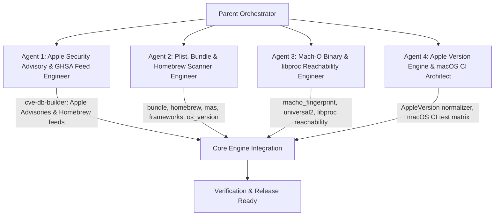

# Architecture & Implementation Plan: Native macOS Scanner

> **Status: NOT IMPLEMENTED — forward-looking plan.** Nothing in this document
> has been built. Evedoo is Windows-only today (`winreg` emits a
> `compile_error!` on other platforms). This is a design/architecture proposal
> for a future phase, listed under "What's next" in
> `evedoo/IMPROVEMENT_ROADMAP.md`.

## 1. Executive Summary & Vision

This plan establishes the architecture and multiagent implementation strategy for **Evedoo's Native macOS Scanner**, delivering deep, agentless, zero-external-shell vulnerability scanning across Apple macOS systems:

* **macOS Operating System Support**:
  * macOS 15 Sequoia, macOS 14 Sonoma, macOS 13 Ventura, macOS 12 Monterey, macOS 11 Big Sur, and future releases.
  * Native parsing of `/System/Library/CoreServices/SystemVersion.plist` (ProductVersion, ProductBuildVersion) and Darwin kernel versions (`uname -v`).
* **Software Inventory Sources**:
  * **Application Bundles** (`/Applications`, `~/Applications`, `/System/Applications`): Pure Rust binary & XML `Info.plist` parsing for `CFBundleIdentifier`, `CFBundleShortVersionString`, `CFBundleVersion`, `LSMinimumSystemVersion`.
  * **Homebrew Package Manager**: Direct filesystem parsing of Homebrew Cellar (`/opt/homebrew/Cellar` on Apple Silicon, `/usr/local/Cellar` on Intel) and Caskroom (`/opt/homebrew/Caskroom`, `/usr/local/Caskroom`).
  * **Mac App Store (MAS)**: `_MASReceipt/receipt` container detection and version mapping.
  * **Frameworks & Bundled Runtimes**: `/Library/Frameworks` and embedded app frameworks (`App.app/Contents/Frameworks/*.framework`).
  * **MacPorts**: Direct SQLite registry parsing (`/opt/local/var/macports/registry/registry.db`).
  * **Language & Developer Ecosystems**: Global & local `pip`, `npm`, `cargo`, and Go binaries.
* **Deep Binary & Mach-O Fingerprinting**:
  * Mach-O 64-bit (`MH_MAGIC_64` / `0xFEEDFACF`) and Universal 2 Fat Binary (`FAT_MAGIC` / `0xCAFEBABE`, `FAT_MAGIC_64`) parsing.
  * Extraction of `LC_LOAD_DYLIB` / `LC_ID_DYLIB` load commands to identify bundled and dynamic libraries (e.g. `libssl.dylib`, `libcrypto.dylib`, `libcurl.dylib`, `libsqlite3.dylib`).
  * Code signature (`LC_CODE_SIGNATURE`) and Team ID / Developer provenance extraction.
* **Runtime In-Memory Reachability**:
  * Pure Rust FFI to `libproc` (`proc_pidinfo` with `PROC_PIDLISTLIB` / `PROC_PIDREGIONPATHINFO`) to map currently loaded `.dylib` libraries and running Mach-O processes in memory.
* **Authoritative Vulnerability Feeds**:
  * **Apple Security Releases / Advisories (HT201222 / Apple Product Security)**: Ingested into `vulndb.sqlite` mapping macOS build updates and Safari/Xcode security fixes directly to CVEs.
  * **Homebrew & GitHub Advisory Database (GHSA)**: Direct mapping for Homebrew formulae.
  * **NVD CPE Fallback**: In-memory `CpeIndex` and CPE dictionary matching for third-party macOS desktop apps.

```
                                  ┌────────────────────────────────────────────────────────┐
                                  │                  Evedoo macOS Scanner                │
                                  └───────────────────────────┬────────────────────────────┘
                                                              │
        ┌─────────────────────────────┬───────────────────────┼───────────────────────┬────────────────────────────┐
        ▼                             ▼                       ▼                       ▼                            ▼
┌───────────────┐             ┌───────────────┐       ┌───────────────┐       ┌───────────────┐            ┌───────────────┐
│ App Bundles   │             │ Homebrew      │       │ Mac App Store │       │ Mach-O & Dylib│            │ libproc       │
│ /Applications │             │ Formulae &    │       │ _MASReceipt   │       │ Universal 2   │            │ Reachability  │
│ Info.plist    │             │ Caskroom      │       │ Receipts      │       │ Fingerprint   │            │ proc_pidinfo  │
└───────┬───────┘             └───────┬───────┘       └───────┬───────┘       └───────┬───────┘            └───────┬───────┘
        │                             │                       │                       │                            │
        │   ┌─────────────────────────┴───────────────────────┴───────────────────────┴────────────────────────────┘
        │   │
        ▼   ▼
┌────────────────────────────────────────────────────────────────────────────────────────────────────────────────────────┐
│                                         macOS Normalization & Matcher Engine                                           │
│  • Apple Version Normalizer (Semver + Build IDs e.g. 15.1.1 [24B91])                                                  │
│  • Apple Product Security Advisories + Homebrew GHSA Feeds + In-Memory NVD CpeIndex                                    │
│  • In-Memory Reachability Tagging via libproc (Active In-Memory vs. Dormant Disk Artifacts)                             │
└────────────────────────────────────────────────────────────────────────────────────────────────────────────────────────┘
```

---

## 2. Multiagent Task Delegation Architecture

The macOS implementation will be dispatched across **4 specialized subagents**:



### Agent Roles & Deliverables

#### Agent 1: Apple Security Advisory & GHSA Feed Engineer (`cve-db-builder`)
* Ingest Apple Security Updates and Homebrew Advisories in `cve-db-builder`:
  * **Apple Security Advisories (HT201222)**: Automated scraping/JSON parsing of Apple's security update index (`https://support.apple.com/en-us/HT201222` / `https://support.apple.com/en-us/100100`).
  * **GitHub Advisory Database (GHSA) for Homebrew**: Ingest Homebrew formula CVE mappings.
* Schema additions in `vulndb.sqlite`:
  ```sql
  CREATE TABLE IF NOT EXISTS macos_advisories (
      cve_id TEXT NOT NULL,
      advisory_id TEXT,             -- APPLE-SA-XXXX, GHSA-XXXX-XXXX
      product_name TEXT NOT NULL,   -- 'macOS', 'Safari', 'Xcode', 'Command Line Tools'
      affected_version TEXT NOT NULL,
      fixed_version TEXT NOT NULL,  -- e.g. '15.1 (24B91)'
      fixed_build TEXT,             -- e.g. '24B91'
      status TEXT NOT NULL,
      PRIMARY KEY (cve_id, product_name, fixed_version)
  );
  CREATE INDEX IF NOT EXISTS idx_macos_adv ON macos_advisories(product_name);
  ```

#### Agent 2: Plist, Application Bundle & Homebrew Scanner Engineer (`evedoo/src/scanner/macos/`)
* **Application Bundle Scanner** (`bundle.rs`):
  * Walk `/Applications`, `~/Applications`, `/System/Applications`.
  * Pure Rust XML & Binary Property List parser (`plist` parsing) extracting `CFBundleIdentifier`, `CFBundleShortVersionString`, `CFBundleVersion`, `CFBundleName`.
  * Scheme prefix: `bundle://{CFBundleIdentifier}` or `app://{name}`.
* **Homebrew Scanner** (`homebrew.rs`):
  * Inspect Apple Silicon (`/opt/homebrew`) and Intel (`/usr/local`) installations.
  * Parse Formulae Cellar directories (`{cellar}/{formula}/{version}/INSTALL_RECEIPT.json`).
  * Parse Caskroom directories (`{caskroom}/{cask}/.metadata/`).
  * Scheme prefix: `brew://{formula}` and `cask://{cask}`.
* **Mac App Store Receipt Scanner** (`mas.rs`):
  * Parse `Contents/_MASReceipt/receipt` in installed apps.
* **Framework Scanner** (`frameworks.rs`):
  * Scan `/Library/Frameworks` and embedded `Frameworks/` subdirectories.
* **OS & Darwin Kernel Scanner** (`os_version.rs`):
  * Parse `/System/Library/CoreServices/SystemVersion.plist` (`ProductVersion`, `ProductBuildVersion`, `ProductName`).
  * Scheme prefix: `os://macos`.

#### Agent 3: Mach-O Binary Fingerprinting & libproc Reachability Engineer
* **Mach-O & Universal 2 Fingerprinter** (`macho_fingerprint.rs`):
  * Parse Mach-O 32/64-bit and Universal Fat binary headers.
  * Extract dynamic library load commands (`LC_LOAD_DYLIB`, `LC_ID_DYLIB`, `LC_RPATH`) to detect standalone bundled libraries (`libssl.dylib`, `libcrypto.dylib`, `libcurl.dylib`, `libsqlite3.dylib`).
  * Extract `.rodata` and `__cstring` embedded version markers.
  * Extract Code Signing metadata (`LC_CODE_SIGNATURE`) for signing identity / Team ID.
* **libproc In-Memory Reachability Analyzer** (`reachability.rs`):
  * Interface with macOS kernel via `proc_pidinfo` and `proc_listpids` (using `libc` FFI without shelling).
  * Enumerate all loaded shared libraries per process.
  * Correlate vulnerable dylib files against active in-memory processes, tagging findings with `is_reachable: true` and `active_pids: [501, ...]`.

#### Agent 4: Apple Version Engine & macOS CI Architect
* **Apple Version Normalizer** (`normalize/apple_version.rs`):
  * Parse and compare Apple version schemes:
    * Standard dotted triplets: `15.1.1`
    * Apple build identifiers: `24B91` (Major year/letter/minor increment)
    * Darwin kernel versions: `Darwin 24.1.0`
* **Workspace & Cross-Platform Integration**:
  * Platform-gate macOS-specific dependencies and modules (`#[cfg(target_os = "macos")]`).
  * Wire macOS scan pipeline in `evedoo/src/main.rs`.
  * Add macOS runner (`macos-14` / `macos-latest` on Apple Silicon) to `.github/workflows/ci.yml`.

---

## 3. Detailed Component Specifications

### 3.1. macOS Discovery Data Sources

| Source | Target Path | Parser Mechanism | Key Attributes |
|---|---|---|---|
| **OS Version** | `/System/Library/CoreServices/SystemVersion.plist` | Binary / XML Plist | `ProductVersion`, `ProductBuildVersion` |
| **App Bundles** | `/Applications/*.app/Contents/Info.plist` | Binary / XML Plist | `CFBundleIdentifier`, `CFBundleShortVersionString` |
| **Homebrew Formulae** | `/opt/homebrew/Cellar/*/*/INSTALL_RECEIPT.json` | JSON stream | `name`, `version`, `installed_as_dependency` |
| **Homebrew Casks** | `/opt/homebrew/Caskroom/*/.metadata/*/` | Filesystem layout | `cask_name`, `version` |
| **Mach-O Binaries** | `/usr/local/bin`, `/opt/homebrew/bin`, `/Library` | Mach-O 64 / Fat header | `LC_LOAD_DYLIB`, `LC_ID_DYLIB`, SONAME |
| **Frameworks** | `/Library/Frameworks/*.framework/Resources/Info.plist` | Plist reader | `CFBundleIdentifier`, `CFBundleVersion` |
| **Active Processes** | `libproc` API (`proc_pidinfo`) | Pure Rust FFI | Active memory-mapped dylibs per PID |

---

### 3.2. Mach-O & Universal Binary Structure

```
Universal 2 Fat Binary (FAT_MAGIC: 0xCAFEBABE)
├── Architecture 1: ARM64 (CPU_TYPE_ARM64: 0x0100000C)
│   ├── Mach-O 64-bit Header (MH_MAGIC_64: 0xFEEDFACF)
│   ├── LC_LOAD_DYLIB: /usr/lib/libSystem.B.dylib
│   ├── LC_LOAD_DYLIB: @rpath/libssl.3.dylib (Bundled OpenSSL)
│   └── LC_CODE_SIGNATURE: Apple Development / Third Party
└── Architecture 2: x86_64 (CPU_TYPE_X86_64: 0x01000007)
    ├── Mach-O 64-bit Header
    └── LC_LOAD_DYLIB: @rpath/libssl.3.dylib
```

---

## 4. Proposed Changes by File

### Cargo Workspace & Configurations
* **`[MODIFY]` [evedoo/Cargo.toml](evedoo/Cargo.toml)**: Add macOS target dependencies (`libc` on macOS).
* **`[MODIFY]` [.github/workflows/ci.yml](.github/workflows/ci.yml)**: Add `macos-latest` (M-series Apple Silicon) to CI matrix.

### Database Builder (`cve-db-builder`)
* **`[NEW]` `cve-db-builder/src/macos_advisories.rs`**: Ingest Apple Security Updates (HT201222) and Homebrew GHSA feeds into `vulndb.sqlite`.
* **`[MODIFY]` [cve-db-builder/src/main.rs](cve-db-builder/src/main.rs)**: Wire macOS feed synchronization.

### Version Normalization (`evedoo/src/normalize/`)
* **`[NEW]` `evedoo/src/normalize/apple_version.rs`**: Apple version & build ID normalizer.

### macOS Scanners (`evedoo/src/scanner/macos/`)
* **`[NEW]` `evedoo/src/scanner/macos/mod.rs`**: macOS scanner module root.
* **`[NEW]` `evedoo/src/scanner/macos/bundle.rs`**: Application Bundle & Plist parser (`bundle://`).
* **`[NEW]` `evedoo/src/scanner/macos/homebrew.rs`**: Homebrew Formulae & Casks parser (`brew://`, `cask://`).
* **`[NEW]` `evedoo/src/scanner/macos/mas.rs`**: Mac App Store receipt scanner (`mas://`).
* **`[NEW]` `evedoo/src/scanner/macos/frameworks.rs`**: Frameworks and embedded bundle parser (`framework://`).
* **`[NEW]` `evedoo/src/scanner/macos/os_version.rs`**: macOS SystemVersion.plist & Darwin kernel scanner (`os://macos`).
* **`[NEW]` `evedoo/src/scanner/macos/macho_fingerprint.rs`**: Mach-O 64-bit and Universal 2 binary & dylib scanner.
* **`[NEW]` `evedoo/src/scanner/macos/reachability.rs`**: `libproc` in-memory process & loaded dylib reachability analyzer.

### Scanner Execution & Matcher
* **`[MODIFY]` [evedoo/src/scanner/mod.rs](evedoo/src/scanner/mod.rs)**: Add `pub mod macos` conditionally under `#[cfg(target_os = "macos")]`.
* **`[MODIFY]` [evedoo/src/matcher/cpe.rs](evedoo/src/matcher/cpe.rs)**: Apple advisory & Homebrew GHSA correlation.
* **`[MODIFY]` [evedoo/src/main.rs](evedoo/src/main.rs)**: Dispatch macOS scan pipeline.

---

## 5. Verification Plan

### Automated Tests
1. **Apple Version & Build ID Comparison Suite**:
   * Verify build ID ordering (`24A348` < `24B91`) and semantic triplet ordering.
   * Command: `cargo test -p evedoo normalize::apple_version`
2. **Plist & Bundle Parsing Suite**:
   * Parse synthetic XML and Binary Plist test fixtures for standard and edge-case bundles.
   * Command: `cargo test -p evedoo scanner::macos::bundle`
3. **Homebrew Cellar & Cask Parsing Suite**:
   * Parse sample `INSTALL_RECEIPT.json` fixtures and Caskroom layout.
   * Command: `cargo test -p evedoo scanner::macos::homebrew`
4. **Mach-O & Universal 2 Fingerprinting Suite**:
   * Inspect mock Mach-O 64-bit and Universal Fat binary headers, verifying `LC_LOAD_DYLIB` extraction.
   * Command: `cargo test -p evedoo scanner::macos::macho_fingerprint`
5. **Apple Security Advisory Ingestion Tests**:
   * Ingest sample HT201222 advisories into `vulndb.sqlite` and query fixed macOS builds.
   * Command: `cargo test -p cve-db-builder macos_advisories`
6. **Full Workspace Clippy & Test Gates**:
   * Command: `cargo clippy --all-targets -- -D warnings`
   * Command: `cargo test`

### Manual Verification
* Run `cargo run --release -p evedoo -- scan` on macOS 14 / macOS 15 (Apple Silicon & Intel).
* Verify discovery of all `/Applications` bundles, Homebrew packages, and active kernel CVEs.
* Verify memory reachability tags on running background daemons (`launchd`, `sshd`, `brew services`).
* Inspect generated HTML, CycloneDX SBOM, and JSON reports.
