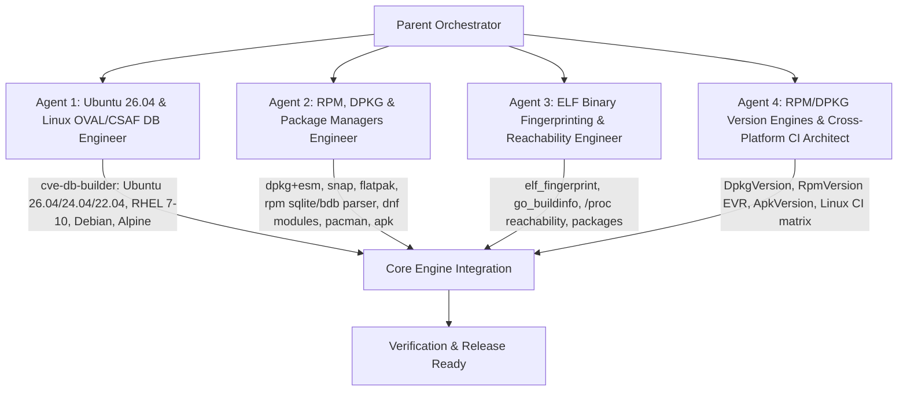

# Architecture & Implementation Plan: Universal Linux Scanner (with RHEL & Ubuntu 26.04 Support)

> **Status: NOT IMPLEMENTED — forward-looking plan.** Nothing in this document
> has been built. Evedoo is Windows-only today (`winreg` emits a
> `compile_error!` on other platforms). This is a design/architecture proposal
> for a future phase, listed under "What's next" in
> `evedoo/IMPROVEMENT_ROADMAP.md`.

## 1. Executive Summary & Vision

This plan establishes the architecture and multiagent implementation strategy for **Evedoo's Universal Linux Scanner**, featuring deep, first-class support for **Ubuntu (including modern Ubuntu 26.04 LTS, 24.04 LTS, 22.04 LTS, and 20.04 LTS)** and **Red Hat Enterprise Linux (RHEL 7 / 8 / 9 / 10)**, alongside the broader enterprise Linux family:

* **Ubuntu Linux (Ubuntu 26.04 LTS, 24.04 LTS, 22.04 LTS, 20.04 LTS)**:
  * Native DPKG status parser (`/var/lib/dpkg/status`).
  * Dynamic Canonical OVAL v2 / USN security notices sync for all active and future releases (including 26.04).
  * Ubuntu Pro / ESM (Expanded Security Maintenance) repository and patch tracking.
  * Snap system metadata & sandboxed AppArmor profile inspection (`core24` / `core26` runtime bases).
* **Red Hat Enterprise Linux (RHEL 7 / 8 / 9 / 10)** & RHEL derivatives (CentOS, Rocky Linux, AlmaLinux, Oracle Linux, Fedora, Amazon Linux 2023):
  * Multi-generation RPM database parser (SQLite `rpmdb.sqlite` + BDB + NDB).
  * DNF AppStream modularity tracking (`/var/lib/dnf/module_states.json`).
  * Authoritative Red Hat OVAL v2 & CSAF 2.0 / VEX security advisories (RHSA/RHBA/RHEA).
  * Backport-aware RPM EVR (`rpmvercmp`) version comparison.
* **Debian family** (Debian 11/12/13) via DPKG & Debian Security Tracker.
* **SUSE Enterprise & openSUSE** (SLES 12/15, openSUSE Leap/Tumbleweed) via RPM & Zypper.
* **Alpine Linux** (Alpine 3.x, container micro-images) via APK databases & Alpine SecDB.
* **Arch Linux family** (Arch, Manjaro) via Pacman.
* **Universal Formats** (Snap, Flatpak, AppImage).
* **Language & Application Ecosystems** (Pip, Npm, Cargo, Go binaries with embedded `.go.buildinfo`).
* **Deep Binary & Shared Library Fingerprinting** (ELF 32/64 header parsing, SONAME, GNU build-id, `.rodata` version extraction).
* **Runtime In-Memory Reachability** (`/proc/[pid]/maps` & `/proc/[pid]/exe` active process correlation).

```
                                  ┌────────────────────────────────────────────────────────┐
                                  │                  Evedoo Linux Scanner                │
                                  └───────────────────────────┬────────────────────────────┘
                                                              │
        ┌─────────────────────────────┬───────────────────────┼───────────────────────┬────────────────────────────┐
        ▼                             ▼                       ▼                       ▼                            ▼
┌───────────────┐             ┌───────────────┐       ┌───────────────┐       ┌───────────────┐            ┌───────────────┐
│Ubuntu/Debian  │             │ RHEL / RPM    │       │Pacman Scanner │       │  APK Scanner  │            │ ELF & .so     │
│(26.04/24.04/..│             │(RHEL 7-10)    │       │/var/lib/pacman│       │/lib/apk/db/   │            │ Fingerprinter │
│DPKG+Snap+ESM  │             │SQLite/BDB/NDB │       │ /local/       │       │ installed     │            │ SONAME/BuildID│
│/var/lib/dpkg/ │             │+ DNF Modules  │       │               │       │               │            │ + Go BuildInfo│
└───────┬───────┘             └───────┬───────┘       └───────┬───────┘       └───────┬───────┘            └───────┬───────┘
        │                             │                       │                       │                            │
        │   ┌─────────────────────────┴───────────────────────┴───────────────────────┴────────────────────────────┘
        │   │
        ▼   ▼
┌────────────────────────────────────────────────────────────────────────────────────────────────────────────────────────┐
│                                       Multi-Distro Normalization & Matcher Engine                                     │
│  • Canonical USN/OVAL Ingestion (Ubuntu 26.04, 24.04, 22.04, 20.04 + Ubuntu Pro ESM)                                   │
│  • Red Hat OVAL v2 / CSAF 2.0 VEX (RHEL 7-10 backport EVR matching)                                                   │
│  • Debian SecTracker + Alpine SecDB + In-Memory NVD CpeIndex Fallback                                                 │
│  • Distro Comparators: DpkgVersion (Debian §5.6.12), RpmVersion (RPM EVR), ApkVersion, Version (Semver/Calver)        │
│  • Runtime Reachability Tagging via /proc/[pid]/maps (Active In-Memory vs. Dormant Disk)                             │
└────────────────────────────────────────────────────────────────────────────────────────────────────────────────────────┘
```

---

## 2. Ubuntu 26.04 & Modern Ubuntu Architecture

### 2.1. Dynamic Release & OVAL Feed Resolution
Ubuntu 26.04 LTS introduces modern system architectures and updated feed endpoints. Evedoo dynamically resolves and ingests:
* **Canonical Ubuntu OVAL Feeds**:
  * Ubuntu 26.04: `https://security-metadata.canonical.com/oval/com.ubuntu.26.04.cve.oval.xml.bz2` (and codename feed `com.ubuntu.<codename>.cve.oval.xml.bz2`)
  * Ubuntu 24.04 LTS (`noble`): `https://security-metadata.canonical.com/oval/com.ubuntu.noble.cve.oval.xml.bz2`
  * Ubuntu 22.04 LTS (`jammy`): `https://security-metadata.canonical.com/oval/com.ubuntu.jammy.cve.oval.xml.bz2`
  * Ubuntu 20.04 LTS (`focal`): `https://security-metadata.canonical.com/oval/com.ubuntu.focal.cve.oval.xml.bz2`
* **Canonical Ubuntu Security Notices (USN) JSON API**:
  * Direct synchronization of USN errata mappings for all active releases.

### 2.2. Ubuntu Pro & ESM (Expanded Security Maintenance) Tracking
Ubuntu systems frequently enable Ubuntu Pro (ESM Apps & ESM Infra) providing security patches beyond standard repositories (e.g. `2:1.18.0-0ubuntu1.4+esm2`):
* Inspect `/var/lib/ubuntu-advantage/` and `/etc/apt/sources.list.d/ubuntu-esm-*.list`.
* Correctly match ESM version strings against Canonical OVAL definitions without flagging ESM-patched packages as vulnerable.

### 2.3. Snap & Container Base Runtimes
Ubuntu 24.04 and 26.04 rely heavily on Snap packages for system utilities and server workloads:
* Scan `/var/lib/snapd/snaps/` and `/snap/*/current/meta/snap.yaml`.
* Map underlying base runtimes (`core20`, `core22`, `core24`, `core26`) and application binaries.

---

## 3. Red Hat Enterprise Linux (RHEL) Architecture

### 3.1. Enterprise Backported Fixes (The RHEL Problem)
* Security fixes in RHEL (7, 8, 9, 10) are backported directly into stable version lines (e.g. `openssl-3.0.7-18.el9_2.x86_64`).
* Ingest authoritative **Red Hat OVAL v2 / CSAF 2.0 VEX** security data to evaluate the exact RPM EVR (`[Epoch:]Version-Release`) threshold.

### 3.2. Multi-Generation RPM Database Engine
* **SQLite Database (RHEL 8.2+, RHEL 9, RHEL 10, Fedora, Amazon Linux 2023)**: `/var/lib/rpm/rpmdb.sqlite`.
* **Berkeley DB (RHEL 7, RHEL 8.0/8.1, CentOS 7)**: `/var/lib/rpm/Packages`.
* **NDB Engine**: `/var/lib/rpm/Packages.db`.

### 3.3. DNF AppStream / Modularity Stream Support
* Parse `/var/lib/dnf/module_states.json` and RPM `Modularitylabel` headers for parallel application streams.

---

## 4. Multiagent Task Delegation Architecture

Work is partitioned across **4 specialized subagents**:



### Agent Roles & Deliverables

#### Agent 1: Ubuntu 26.04 & Linux Multi-Distro DB Engineer (`cve-db-builder`)
* Multi-distro advisory ingestion in `cve-db-builder`:
  * **Canonical Ubuntu OVAL feeds** for Ubuntu **26.04**, **24.04**, **22.04**, **20.04**, and ESM.
  * **Red Hat OVAL v2 & CSAF 2.0 feeds** for RHEL **7, 8, 9, 10**.
  * **Debian Security Tracker JSON feeds** (Bookworm, Bullseye, Trixie).
  * **Alpine SecDB feeds** (v3.18, v3.19, v3.20).
* Schema extensions in `vulndb.sqlite`:
  ```sql
  CREATE TABLE IF NOT EXISTS distro_advisories (
      cve_id TEXT NOT NULL,
      advisory_id TEXT,             -- USN-XXXX-X, RHSA-YYYY:XXXX, etc.
      distro_family TEXT NOT NULL,  -- 'ubuntu', 'rhel', 'debian', 'suse', 'alpine'
      package_name TEXT NOT NULL,
      release_codename TEXT,        -- '26.04', 'noble', 'jammy', 'focal', 'el9', 'el8', etc.
      fixed_version TEXT NOT NULL,  -- Exact EVR fixed string e.g. '2:1.18.0-0ubuntu1.4'
      status TEXT NOT NULL,         -- 'fixed', 'affected', 'under_investigation'
      modularity_stream TEXT,       -- Optional DNF/Snap stream
      PRIMARY KEY (cve_id, distro_family, package_name, release_codename, modularity_stream)
  );
  CREATE INDEX IF NOT EXISTS idx_distro_adv 
  ON distro_advisories(distro_family, package_name, release_codename);
  ```

#### Agent 2: RPM, DPKG & Package Managers Engineer (`evedoo/src/scanner/linux/`)
* **DPKG Scanner** (`dpkg.rs`): Hand-parse `/var/lib/dpkg/status` supporting Ubuntu 26.04, 24.04, Debian 12, and ESM tags (`dpkg://{package_name}`).
* **RPM Scanner** (`rpm.rs`): Parse SQLite RPM databases (`/var/lib/rpm/rpmdb.sqlite`), BDB, NDB, and DNF modularity states (`rpm://{package_name}`).
* **Pacman Scanner** (`pacman.rs`): Parse `/var/lib/pacman/local/*/desc` (`pacman://{package_name}`).
* **APK Scanner** (`apk.rs`): Parse `/lib/apk/db/installed` (`apk://{package_name}`).
* **Snap & Flatpak Scanners** (`snap.rs`, `flatpak.rs`).
* **OS Release & Kernel Scanner** (`os_release.rs`): Inspect `/etc/os-release` (`ID=ubuntu`, `VERSION_ID="26.04"`), `/etc/redhat-release`, `/proc/version`.

#### Agent 3: Binary Fingerprinting & Runtime Reachability Engineer
* **ELF & Shared Library Fingerprinter** (`elf_fingerprint.rs`):
  * Parse 32/64-bit ELF headers (`\x7fELF`), `.dynamic` (`DT_SONAME`), `.rodata` version markers, `.note.gnu.build-id`.
  * Detect standalone unmanaged libraries (`libssl.so`, `libcrypto.so`, `libcurl.so`, `libsqlite3.so`, `libxml2.so`).
* **Go Module BuildInfo Extractor** (`go_buildinfo.rs`):
  * Parse ELF `.go.buildinfo` section to extract embedded Go dependencies and versions.
* **Language Package Scanners** (`packages.rs`): `pip://`, `npm://`, `cargo://`.
* **Runtime Reachability Analyzer** (`reachability.rs`):
  * Inspect `/proc/[pid]/maps` and `/proc/[pid]/exe` to tag active in-memory vulnerabilities.

#### Agent 4: RPM/DPKG Version Engines & Cross-Platform CI Architect
* **Debian & Ubuntu Version Comparator** (`normalize/dpkg_version.rs`):
  * Conforming to Debian Policy §5.6.12 with support for Ubuntu revisions (`-0ubuntu1.4`, `+esm2`) and tildes (`~`).
* **RPM EVR Version Comparator** (`normalize/rpm_version.rs`):
  * Exact `rpmvercmp` algorithm supporting Epochs, Versions, Releases, tildes `~` (pre-release), and carets `^` (post-release).
* **Alpine Version Comparator** (`normalize/apk_version.rs`).
* **Workspace & Cross-Platform Integration**:
  * Platform-gate `winreg` in `evedoo/Cargo.toml`.
  * Wire cross-platform `run_scan` dispatch in `evedoo/src/main.rs`.
  * Expand `.github/workflows/ci.yml` matrix with `ubuntu-latest` and `windows-latest`.

---

## 5. Proposed Changes by File

### Cargo Workspace & Configurations
* **`[MODIFY]` [evedoo/Cargo.toml](evedoo/Cargo.toml)**: Platform-gate `winreg`, ensure cross-platform dependencies.
* **`[MODIFY]` [cve-db-builder/Cargo.toml](cve-db-builder/Cargo.toml)**: Multi-distro decompression (`bz2`, `xz`, `gzip`, `json`).
* **`[MODIFY]` [.github/workflows/ci.yml](.github/workflows/ci.yml)**: Add Linux test matrix job.

### Database Builder (`cve-db-builder`)
* **`[NEW]` `cve-db-builder/src/distro_oval/mod.rs`**: Multi-distro OVAL/CSAF coordinator.
* **`[NEW]` `cve-db-builder/src/distro_oval/ubuntu.rs`**: Canonical Ubuntu OVAL v2 (26.04, 24.04, 22.04, 20.04) parser.
* **`[NEW]` `cve-db-builder/src/distro_oval/redhat.rs`**: Red Hat OVAL v2 & CSAF 2.0 parser (RHEL 7-10).
* **`[NEW]` `cve-db-builder/src/distro_oval/debian.rs`**: Debian Security Tracker parser.
* **`[NEW]` `cve-db-builder/src/distro_oval/alpine.rs`**: Alpine SecDB parser.
* **`[MODIFY]` [cve-db-builder/src/main.rs](cve-db-builder/src/main.rs)**: Wire distro advisory sync into `--update`.

### Version Normalization (`evedoo/src/normalize/`)
* **`[NEW]` `evedoo/src/normalize/dpkg_version.rs`**: Debian & Ubuntu Policy §5.6.12 version comparison.
* **`[NEW]` `evedoo/src/normalize/rpm_version.rs`**: RPM EVR comparison algorithm with `~` and `^`.
* **`[NEW]` `evedoo/src/normalize/apk_version.rs`**: Alpine apk version comparison.

### Linux Scanners (`evedoo/src/scanner/linux/`)
* **`[NEW]` `evedoo/src/scanner/linux/mod.rs`**: Linux scanner module root.
* **`[NEW]` `evedoo/src/scanner/linux/dpkg.rs`**: DPKG status file hand-parser (Ubuntu 26.04/24.04/22.04 & Debian).
* **`[NEW]` `evedoo/src/scanner/linux/rpm.rs`**: RPM database parser (SQLite + BDB + DNF modules).
* **`[NEW]` `evedoo/src/scanner/linux/pacman.rs`**: Pacman registry reader.
* **`[NEW]` `evedoo/src/scanner/linux/apk.rs`**: Alpine APK installed database reader.
* **`[NEW]` `evedoo/src/scanner/linux/snap.rs`**: Snap package detector (core20-core26).
* **`[NEW]` `evedoo/src/scanner/linux/flatpak.rs`**: Flatpak package detector.
* **`[NEW]` `evedoo/src/scanner/linux/os_release.rs`**: OS & kernel release detection (Ubuntu 26.04, RHEL, etc.).
* **`[NEW]` `evedoo/src/scanner/linux/elf_fingerprint.rs`**: ELF 32/64 header & `.so` scanner.
* **`[NEW]` `evedoo/src/scanner/linux/go_buildinfo.rs`**: Go binary `.go.buildinfo` extractor.
* **`[NEW]` `evedoo/src/scanner/linux/reachability.rs`**: `/proc/[pid]/maps` memory reachability analyzer.

### Scanner Execution & Matcher
* **`[MODIFY]` [evedoo/src/scanner/mod.rs](evedoo/src/scanner/mod.rs)**: Conditional platform grouping (`windows/`, `linux/`, `common/`).
* **`[MODIFY]` [evedoo/src/matcher/cpe.rs](evedoo/src/matcher/cpe.rs)**: Distro advisory matching with DPKG/EVR comparison & NVD CPE fallback.
* **`[MODIFY]` [evedoo/src/main.rs](evedoo/src/main.rs)**: Cross-platform `run_scan` dispatch.

---

## 6. Verification Plan

### Automated Tests
1. **Ubuntu 26.04 & DPKG Version Comparison Suite**:
   * Test Debian/Ubuntu version comparator against Ubuntu 26.04 package naming conventions (`1:2.4.52-1ubuntu4.1`, `~rc1`, `+esm2`).
   * Command: `cargo test -p evedoo normalize::dpkg_version`
2. **RPM EVR Comparison Suite**:
   * Test `rpmvercmp` against RHEL 7-10 test cases (`el9_3`, `el10_0`, `~`, `^`).
   * Command: `cargo test -p evedoo normalize::rpm_version`
3. **Linux Package Manager Parsing Fixtures**:
   * Synthetic test fixtures for Ubuntu 26.04 `/var/lib/dpkg/status`, RHEL 9 `rpmdb.sqlite`, Alpine `installed`, and Pacman `desc`.
   * Command: `cargo test -p evedoo scanner::linux::`
4. **Canonical Ubuntu 26.04 & Red Hat OVAL Ingestion Tests**:
   * Ingest sample Ubuntu 26.04 OVAL XML and RHSA feeds into `vulndb.sqlite` and query fixed versions.
   * Command: `cargo test -p cve-db-builder distro_oval`
5. **Full Workspace Clippy & Test Gates**:
   * Command: `cargo clippy --all-targets -- -D warnings`
   * Command: `cargo test`

### Manual Verification
* Run `cargo run --release -p evedoo -- scan` on:
  * Ubuntu 26.04 LTS / 24.04 LTS (DPKG + Snap + USN correlation)
  * RHEL 9 / Rocky Linux 9 / AlmaLinux 9 (RPM SQLite + DNF AppStreams + RHSA correlation)
  * Alpine Linux 3.20 container (APK)
* Verify memory reachability tags on running daemons (`sshd`, `httpd`, `nginx`, `postgres`).
* Inspect generated HTML, CycloneDX SBOM, and JSON reports.
